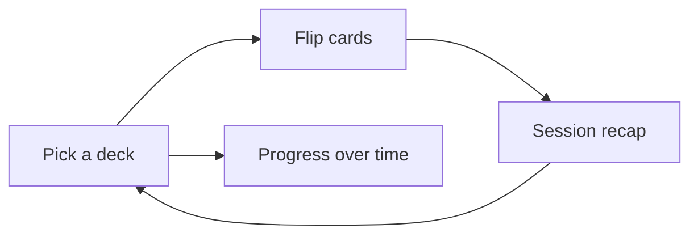

# Elementary flash cards for Android

A single-module Kotlin and Jetpack Compose app (Material 3). No account, no network, and no backend. Stats stay on the device in Room.

This stack is a normal Android app. It produces a debug APK you can install with Android Studio or `adb`. Phone setup is in [ANDROID_SETUP.md](ANDROID_SETUP.md).

## What the child does

- **Home.** Six built-in math decks, large cards, and a small "last time" note when they have played before (for example, "8 of 10 · 1:12"). A mute button and a way into Progress.
- **Play.** One card at a time. Tap to flip. Then two big choices: **Right** and **Not yet**. Default session is 10 cards, shuffled. Cards marked "Not yet" come back once before the session ends. A thin progress bar shows how far through the session they are. A quiet corner of the card shows that card's score and how many times it has been practiced.
- **Session recap.** Plain language: "You got 7 of 10." Time spent. The few cards that want another look, with each card's updated score. One button back to the decks.
- **Fireworks.** Only on the recap, and only when this session strictly beats the previous session of the same deck on both accuracy and time. The first session of a deck never gets fireworks. A tie on either one does not. The burst is short, then the recap is still readable underneath. No fireworks on a single right answer.
- **Progress.** Per card: the problem, its score, and times practiced. Also the recent sessions for that deck (accuracy and time) as simple rows. Empty state until the first answer exists. **Reset this deck** and **Reset everything**, each behind a confirm dialog that says scores and session history will be erased.

## Tone

Fun without a prize economy.

- Warm paper background, large rounded type, big tap targets.
- A small drawn turtle that looks curious on the question, pleased on "Right," and unbothered on "Not yet." Short motion only. No points shop, streaks, or sounds that buzz on a miss. The only celebration is the fireworks rule above.
- "Not yet" uses a clay color, not alarm red. Copy is "Let's see that one again," and the card returns. The score still goes down.
- Optional soft tap sound, on by default, easy to mute. Remembered on the device.

## Decks

Six math decks, generated in the app (no download, no custom lists). Every problem has a stable id so its score survives across sessions. A session draws 10 at random. The front is the problem (`7 + 5`) and the back is the answer (`12`). No negative answers and no remainders.

- **Addition, single digits.** Both addends are 0–9. 100 cards.
- **Addition to 100.** Both addends are whole numbers from 0 to 100, the sum is at most 100, and at least one addend is 10 or more. This keeps the deck from being mostly the single-digit set.
- **Subtraction, single digits.** Both numbers are 0–9, and the first is at least the second. 55 cards.
- **Subtraction to 100.** The first number is 10–100, and the second is a whole number from 0 up to the first.
- **Multiplication, single digits.** Both factors are 0–9. 100 cards.
- **Division to 100, no remainders.** The dividend is 1–100. The divisor is a whole number from 1 through the dividend that divides it exactly. 0 is never a dividend or a divisor.

## Stats model

Each card starts at score `0` and times `0`. There is no separate "knew it" flag.

- **Right:** score +1, times +1
- **Not yet:** score −1, times +1

The score may go below 0. A card that returns in the same session is scored again on the second answer.

Room tables:

- `CardStat`: deck, card, score, times
- `Session`: deck, start, end, duration, right count, answer count

Accuracy for a session is right count / answer count. Fireworks compare this session with the previous `Session` row for that deck: accuracy strictly higher and duration strictly lower. Reset deletes the `CardStat` and `Session` rows for one deck, or all of them. Uninstalling the app clears the data too.

## Project shape

- `settings.gradle.kts`, Gradle wrapper, `app/build.gradle.kts`
- `minSdk 26` (Android 8), `targetSdk 35`, so current phones and older kid tablets both run it
- Packages under `app/src/main/java`: `ui` (home, play, summary, progress), `data` (built-in math decks, repositories), `db` (Room)
- Theme, the turtle, and the short fireworks burst drawn in Compose, so there is no image pipeline

## Checks

Unit tests cover shuffle, the "not yet" requeue, score +1/−1 with times, the fireworks rule (both strictly better, including first-session and tie cases), and reset. The debug build is `./gradlew assembleDebug`.
